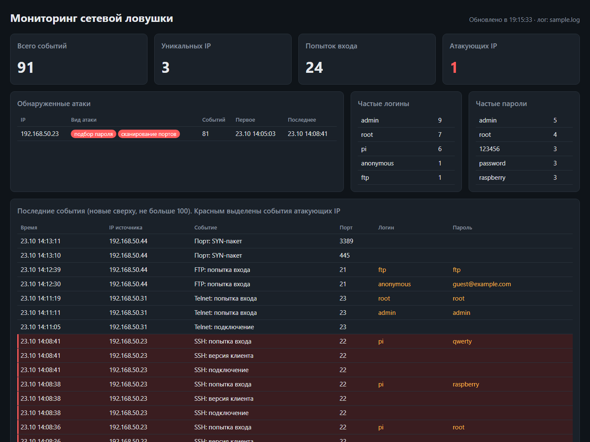
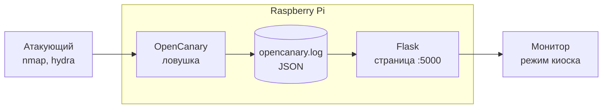

# Сетевая ловушка (honeypot) на Raspberry Pi

Raspberry Pi в локальной сети притворяется старым сетевым хранилищем `nas-backup` с открытыми SSH, Telnet, FTP и веб-страницей входа. Настоящих сервисов за этими портами нет: это ловушка, обычным пользователям обращаться к ней незачем. Поэтому каждое обращение подозрительно, и система его записывает. Сканирование портов и подбор паролей видны в реальном времени на веб-странице, которая открывается на экране самой Pi.



> **Только для учебных целей.** Запускайте атаки только против своей Raspberry Pi в своей изолированной сети. Сканирование и подбор паролей к чужим устройствам без разрешения владельца незаконны (ст. 272 УК РФ).

## Возможности

- Имитация сервисов SSH (22), Telnet (23), FTP (21) и HTTP (80) со страницей входа NAS на базе [OpenCanary](https://github.com/thinkst/opencanary).
- Обнаружение сканирования портов через правила iptables, включая специальные пакеты nmap (определение ОС, NULL, XMAS, FIN).
- Запись каждой попытки входа с логином и паролем.
- Веб-страница мониторинга: последние события, счётчики, частые логины и пароли, список атакующих IP.
- Простые правила обнаружения атак: подбор пароля и сканирование портов.
- Автозапуск через systemd и режим киоска: после включения Pi сама показывает страницу на мониторе.
- Своя точка доступа Wi-Fi: стенд работает без роутера и без интернета.
- Настоящий SSH администратора перенесён на порт 2222 и пускает только по ключу.

## Как это работает



1. **Модуль ловушки.** OpenCanary принимает подключения к поддельным сервисам и с помощью iptables замечает пакеты на закрытые порты. Каждое событие записывается в лог одной строкой JSON.
2. **Модуль мониторинга.** Скрипт [`dashboard/app.py`](dashboard/app.py) (около 120 строк) читает лог, находит атаки по правилам и показывает страницу, которая обновляется каждые 5 секунд.

| Атака | Правило (для одного IP) |
|---|---|
| Подбор пароля | ≥ 5 попыток входа за 60 секунд |
| Сканирование портов | ≥ 10 разных портов за 60 секунд или любой специальный пакет nmap |

Подробности: схема, коды событий, обоснование правил — в [docs/architecture.md](docs/architecture.md).

## Что нужно

- Raspberry Pi 3, 4 или 5 (подойдёт и Zero 2 W) с Wi-Fi;
- карта microSD от 16 ГБ и блок питания;
- монитор или проектор с HDMI (для Pi 4 и Pi 5 нужен переходник micro-HDMI → HDMI). Без монитора страницу можно открыть с любого ноутбука в сети;
- на время установки — интернет (домашний Wi-Fi или кабель);
- для демонстрации — ноутбук с `nmap` и `hydra`.

## Установка

### 1. Запись ОС на карту

1. Установите [Raspberry Pi Imager](https://www.raspberrypi.com/software/).
2. Выберите модель платы, ОС **Raspberry Pi OS (64-bit)** (с рабочим столом) и карту памяти. Для Pi 1, Pi 2 и первой Zero нужна 32-битная версия.
3. В настройках ОС укажите:
   - имя хоста: `nas-backup` (оно тоже работает как приманка);
   - имя пользователя и пароль (не `pi`);
   - Wi-Fi для установки: домашняя сеть, страна `RU`;
   - часовой пояс, например `Asia/Novosibirsk`;
   - SSH: включить, **вход только по открытому ключу**. Ключ можно создать на своём компьютере командой `ssh-keygen -t ed25519`, а в Imager вставить содержимое файла `~/.ssh/id_ed25519.pub`.
4. Запишите карту, вставьте её в Pi и включите.

### 2. Установка проекта

Подключитесь к Pi по SSH (`ssh <пользователь>@nas-backup.local`) или откройте терминал на её рабочем столе и выполните:

```bash
sudo apt install -y git
git clone https://github.com/SaidGoodman/rpi-honeypot.git
cd rpi-honeypot
sudo ./install.sh
```

Скрипт ставит пакеты, OpenCanary, страницу мониторинга, переносит SSH на порт 2222, включает автозапуск и режим киоска. После него переподключайтесь по SSH так:

```bash
ssh -p 2222 <пользователь>@nas-backup.local
```

### 3. Своя точка доступа Wi-Fi (по желанию)

Когда всё установлено, Pi можно переключить на раздачу своей сети. Интернет на Pi после этого пропадёт, он больше не нужен.

```bash
cp config.env.example config.env
nano config.env                 # задайте название сети и пароль
sudo ./system/hotspot.sh on
```

Pi раздаёт сеть `NAS-Backup`, сама получает адрес `192.168.50.1` и выдаёт адреса подключившимся. Вернуться к домашнему Wi-Fi: `sudo ./system/hotspot.sh off`.

### 4. Проверка

```bash
sudo reboot
```

После перезагрузки на мониторе должна открыться страница мониторинга. Проверить службы:

```bash
systemctl status opencanary dashboard
```

Сценарий демонстрации с командами `nmap` и `hydra`: [demo/demo.md](demo/demo.md).

## Что делает install.sh

Каждый шаг можно выполнить руками, если хочется разобраться или что-то пошло не так.

| Шаг | Что делается | Зачем |
|---|---|---|
| 1 | `apt install python3-venv python3-dev build-essential libssl-dev libffi-dev libpcap-dev iptables rsyslog python3-flask curl` | `iptables` даёт программу `iptables-legacy`, без которой не работает обнаружение сканирования; `rsyslog` пишет журнал ядра в `/var/log/kern.log`, откуда OpenCanary читает пойманные пакеты |
| 2 | `python3 -m venv /opt/opencanary/venv` и `pip install opencanary` | в Raspberry Pi OS нельзя ставить пакеты pip в системный Python (PEP 668), поэтому нужно отдельное окружение |
| 3 | копирует [`opencanary/opencanary.conf`](opencanary/opencanary.conf) в `/etc/opencanaryd/` с правами 600 | конфиг читает root, менять его должен только root |
| 4 | копирует `dashboard/` в `/opt/rpi-honeypot/` | оттуда страницу запускает systemd |
| 5 | копирует [`system/sshd-honeypot.conf`](system/sshd-honeypot.conf) в `/etc/ssh/sshd_config.d/10-honeypot.conf`, перезапускает SSH | освобождает порт 22 для ловушки; если ключа ещё нет, вход по паролю временно остаётся |
| 6 | копирует [`opencanary.service`](system/opencanary.service) и [`dashboard.service`](system/dashboard.service) в `/etc/systemd/system/`, включает их | автозапуск и перезапуск при сбое |
| 7 | дописывает [`system/labwc-autostart`](system/labwc-autostart) в `~/.config/labwc/autostart`, включает автовход (`raspi-config nonint do_boot_behaviour B4`) | после включения Chromium сам открывает страницу на весь экран |

## Запуск страницы без Raspberry Pi

Страницу можно проверить на своём компьютере на тестовом логе [`dashboard/sample.log`](dashboard/sample.log). Это синтетические события: сканирование nmap, подбор пароля по SSH, попытки входа по Telnet, FTP и HTTP.

Linux / macOS:

```bash
cd dashboard
python3 -m venv .venv && . .venv/bin/activate
pip install -r requirements.txt
CANARY_LOG=sample.log python3 app.py
```

Windows (PowerShell):

```powershell
cd dashboard
python -m venv .venv; .venv\Scripts\Activate.ps1
pip install -r requirements.txt
$env:CANARY_LOG = "sample.log"; python app.py
```

Откройте <http://localhost:5000>. Проверка правил обнаружения: `python test_rules.py`.

## Структура репозитория

```
├── install.sh              # автоматическая установка на Pi
├── config.env.example      # образец настроек точки доступа (копируется в config.env)
├── opencanary/
│   └── opencanary.conf     # конфиг ловушки: сервисы, приманки, путь к логу
├── dashboard/              # модуль мониторинга
│   ├── app.py              # чтение лога, правила обнаружения, страница
│   ├── templates/index.html
│   ├── sample.log          # тестовый лог
│   ├── test_rules.py       # проверка правил
│   └── requirements.txt
├── system/
│   ├── opencanary.service  # systemd: ловушка
│   ├── dashboard.service   # systemd: страница
│   ├── sshd-honeypot.conf  # настоящий SSH на порту 2222
│   ├── labwc-autostart     # режим киоска
│   └── hotspot.sh          # точка доступа Wi-Fi
├── demo/
│   ├── demo.md             # сценарий демонстрации
│   ├── users.txt           # словарь логинов для hydra
│   └── passwords.txt       # словарь паролей для hydra
└── docs/
    ├── architecture.md     # устройство системы
    └── screenshot.png
```

## Настройка

- **Приманки** — в [`opencanary/opencanary.conf`](opencanary/opencanary.conf): имя узла (`device.node_id`), баннеры и версии сервисов, вид страницы входа (`http.skin`: `nasLogin` или `basicLogin`). После изменения: `sudo ./install.sh` или скопировать конфиг в `/etc/opencanaryd/` и выполнить `sudo systemctl restart opencanary`.
- **Пороги обнаружения** — в начале [`dashboard/app.py`](dashboard/app.py): `BRUTE_LOGINS`, `SCAN_PORTS`, `WINDOW`.

## Если что-то не работает

| Проблема | Что проверить |
|---|---|
| Ловушка не запускается | `journalctl -u opencanary -n 50`. Если порт 22 занят, значит настоящий SSH всё ещё на нём: `sudo ss -tlnp \| grep ':22 '` |
| Нет событий сканирования | правила iptables: `sudo iptables-legacy -t mangle -L PREROUTING -n` (должны быть строки `LOG`); пойманные пакеты: `sudo grep canary /var/log/kern.log \| tail` |
| Страница пустая | есть ли события в логе: `sudo tail /var/log/opencanary.log`; служба страницы: `journalctl -u dashboard -n 50` |
| Киоск не открылся | `cat ~/.config/labwc/autostart` (должна быть строка с `localhost:5000`); выйти из киоска — `Alt+F4` |
| Не подключиться по SSH | порт 2222: `ssh -p 2222 ...`; вход только по ключу, пароль не подойдёт |

## Возможные улучшения

- [Cowrie](https://github.com/cowrie/cowrie) вместо SSH-модуля OpenCanary: ловушка среднего уровня взаимодействия, которая пускает атакующего в поддельную оболочку и записывает его команды.
- Светодиод или зуммер на GPIO, который срабатывает при обнаружении атаки.
- Пароль на страницу мониторинга и доступ к ней только с адреса администратора.
- Ротация лога (`logrotate`) для долгой работы.

## Лицензия

[MIT](LICENSE)
