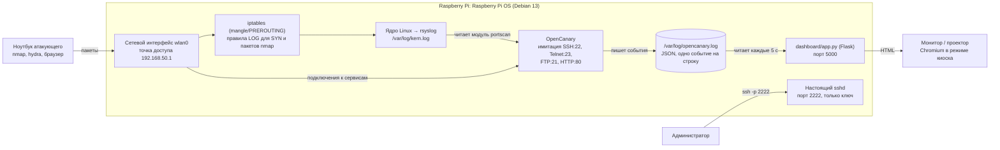

# Архитектура системы

## Общая схема



Система состоит из двух модулей, которые связаны только через лог-файл:

1. **Модуль сетевой ловушки** — OpenCanary и настройка ОС. Он «изображает» сетевое хранилище и записывает каждое обращение.
2. **Модуль мониторинга** — страница на Flask. Читает лог, применяет правила обнаружения и показывает результат.

Такое разделение позволяет менять модули независимо: страница ничего не знает о том, как устроена ловушка, ей нужен только формат строк в логе.

## Что слушает Raspberry Pi

| Порт | Что на нём | Настоящий? |
|---|---|---|
| 21 | FTP (баннер «ProFTPD 1.3.5») | нет, имитация OpenCanary |
| 22 | SSH (версия «OpenSSH 7.4p1 Debian») | нет, имитация OpenCanary |
| 23 | Telnet | нет, имитация OpenCanary |
| 80 | HTTP, страница входа в «сетевое хранилище» (скин `nasLogin`) | нет, имитация OpenCanary |
| 2222 | SSH администратора, только по ключу | да |
| 5000 | Страница мониторинга | да |
| остальные | закрыты, но SYN-пакеты на них ловит iptables | — |

Версии сервисов специально указаны старые: для атакующего это выглядит как давно не обновлявшееся, а значит уязвимое устройство. Имя узла `nas-backup` и страница входа NAS работают как приманка.

## Как обнаруживается каждое событие

**Подключение к сервису (SSH, Telnet, FTP, HTTP).** OpenCanary сам принимает TCP-соединение на нужном порту и ведёт диалог по протоколу ровно до ввода логина и пароля. Пароль никогда не подходит. Каждая попытка записывается в лог с логином и паролем.

**Сканирование портов.** На закрытых портах никто не слушает, поэтому соединения нет. Модуль `portscan` при запуске добавляет правила в таблицу `mangle` iptables: каждый входящий SYN-пакет и характерные пакеты nmap (определение ОС, NULL, XMAS, FIN) записываются ядром в журнал с префиксом `canaryfw:` / `canarynmap...:`. rsyslog складывает эти записи в `/var/log/kern.log`, OpenCanary читает этот файл и превращает строки в события.

Особенности, найденные в исходниках OpenCanary:
- модуль ищет программу `iptables-legacy` и не работает с бэкендом nf_tables;
- частота записи ограничена (`portscan.synrate`, в проекте 50 пакетов в секунду), чтобы сканирование не переполнило журнал;
- порты, на которых работают сервисы ловушки, а также 2222 и 5000, исключены (`portscan.ignore_ports`): обращения к ним и так видны или это своя работа.

## Формат события

Пример строки из `/var/log/opencanary.log` (попытка входа по SSH):

```json
{"dst_host": "192.168.50.1", "dst_port": 22, "local_time": "2026-10-23 07:08:31.512000",
 "local_time_adjusted": "2026-10-23 14:08:31.512000",
 "logdata": {"LOCALVERSION": "SSH-2.0-OpenSSH_7.4p1 Debian-10+deb9u7", "PASSWORD": "password",
             "REMOTEVERSION": "SSH-2.0-libssh_0.10.6", "USERNAME": "pi"},
 "logtype": 4002, "node_id": "nas-backup", "src_host": "192.168.50.23", "src_port": 51734,
 "utc_time": "2026-10-23 07:08:31.512000"}
```

| Поле | Значение |
|---|---|
| `src_host`, `src_port` | откуда пришёл атакующий |
| `dst_host`, `dst_port` | куда он обращался |
| `logtype` | код события (таблица ниже) |
| `logdata` | подробности: логин, пароль, версия клиента, путь HTTP |
| `local_time_adjusted` | местное время события |
| `node_id` | имя ловушки из конфига |

Коды `logtype`, которые использует страница (из файла `opencanary/logger.py`):

| Код | Событие | Группа на странице |
|---|---|---|
| 2000 | FTP: попытка входа | вход |
| 3000 | HTTP: открыта страница | — |
| 3001 | HTTP: попытка входа | вход |
| 4000 | SSH: новое подключение | — |
| 4001 | SSH: клиент сообщил версию | — |
| 4002 | SSH: попытка входа | вход |
| 5001 | SYN-пакет на порт | сканирование |
| 5002 | пакет nmap для определения ОС | сканирование (сразу атака) |
| 5003 / 5004 / 5005 | NULL / XMAS / FIN-сканирование nmap | сканирование (сразу атака) |
| 6001 | Telnet: попытка входа | вход |
| 6002 | Telnet: подключение | — |
| 1000–1006 | служебные сообщения OpenCanary | не показываются |

## Правила обнаружения атак

Правила проверяются отдельно для каждого IP-адреса в скользящем окне 60 секунд (функция `find_attacks` в `dashboard/app.py`):

| Атака | Условие |
|---|---|
| Подбор пароля | ≥ 5 попыток входа (коды 2000, 3001, 4002, 6001) за 60 секунд |
| Сканирование портов | ≥ 10 разных портов в событиях 5001–5005 за 60 секунд **или** хотя бы один пакет 5002–5005 |

Почему так:
- человек, который ошибся паролем, делает 1–3 попытки, а программа перебора — десятки в минуту;
- обычной программе незачем стучаться на десяток разных портов одного устройства за минуту;
- пакеты с флагами NULL, XMAS, FIN и зондирование ОС нормальные программы не отправляют, это признак именно сканера.

Пороги вынесены в начало `app.py` (`BRUTE_LOGINS`, `SCAN_PORTS`, `WINDOW`), их легко поменять. Правила проверяются тестами в `dashboard/test_rules.py`.

## Где что лежит на Raspberry Pi

| Путь | Что это |
|---|---|
| `/opt/opencanary/venv/` | виртуальное окружение Python с OpenCanary |
| `/etc/opencanaryd/opencanary.conf` | конфиг ловушки (только для root) |
| `/var/log/opencanary.log` | события ловушки |
| `/var/log/kern.log` | журнал ядра, откуда берутся события сканирования |
| `/opt/rpi-honeypot/dashboard/` | страница мониторинга |
| `/etc/systemd/system/opencanary.service`, `dashboard.service` | автозапуск |
| `/etc/ssh/sshd_config.d/10-honeypot.conf` | настройки настоящего SSH |
| `~/.config/labwc/autostart` | автозапуск киоска на рабочем столе |

## Порядок запуска после включения

1. Загрузчик и ядро Linux, systemd.
2. NetworkManager поднимает Wi-Fi (точку доступа или подключение к роутеру).
3. rsyslog начинает писать `/var/log/kern.log`, sshd слушает порт 2222.
4. `opencanary.service`: OpenCanary занимает порты 21, 22, 23, 80 и добавляет правила iptables.
5. `dashboard.service`: страница мониторинга на порту 5000.
6. Автоматический вход в рабочий стол, Chromium дожидается страницы и открывает её на весь экран.

## Безопасность самой ловушки

- Ловушка низкого уровня взаимодействия: атакующий не получает оболочку и не может ничего выполнить на Pi.
- Настоящий SSH перенесён на порт 2222 и пускает только по ключу.
- Страница мониторинга работает от временного пользователя без прав (`DynamicUser=yes` в systemd) и только читает лог.
- Стенд работает в изолированной сети без выхода в интернет.
- Ограничения: страница мониторинга без пароля и видна всем в сети стенда. Для учебного стенда это допустимо, в реальной сети её стоит закрыть паролем или открыть только для адреса администратора.
